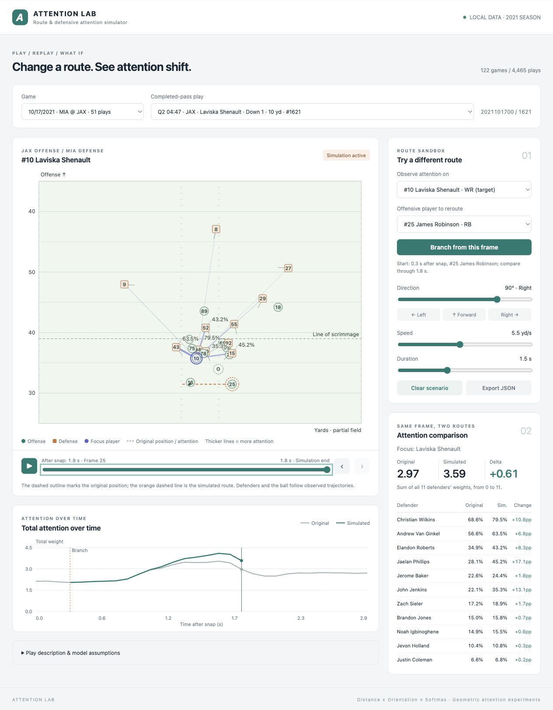
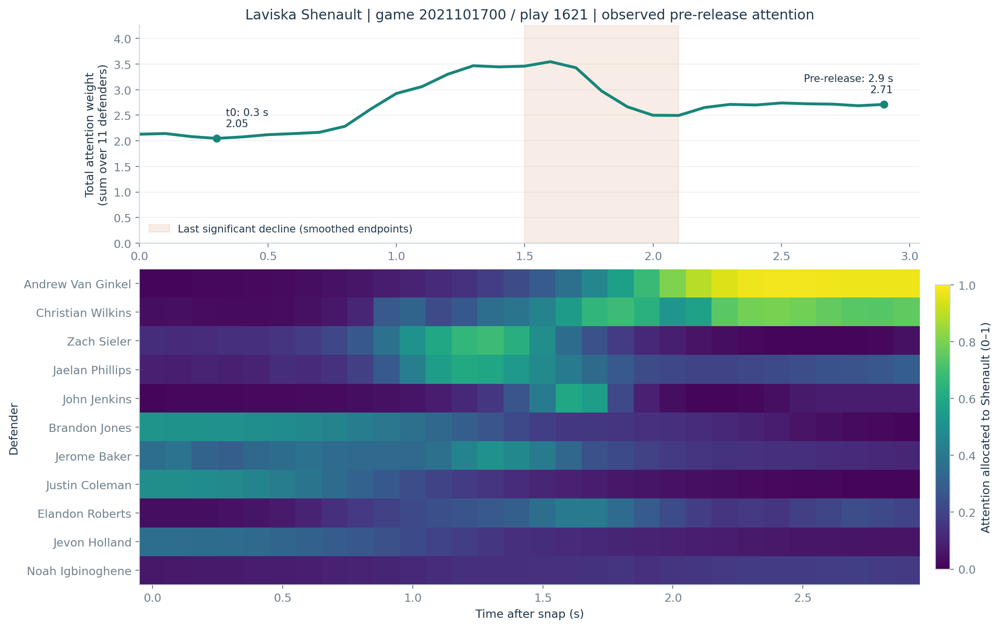
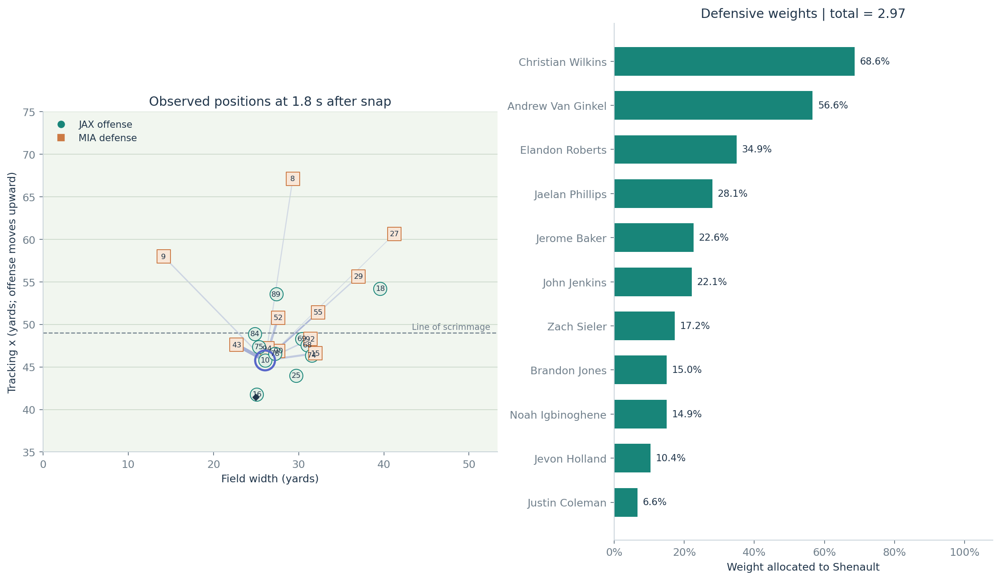
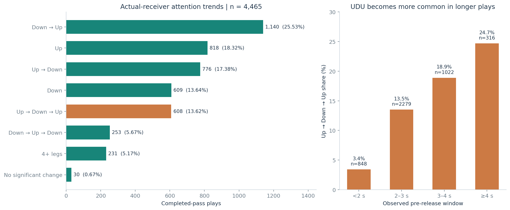

# Attention is all you need

This project models defensive attention in NFL tracking data using player distance, defensive body orientation, and softmax weights. Across 4,465 completed-pass plays, it measures changes in attention to the actual receiver and identifies teammates associated with the receiver's last significant attention decline. The most common trend is a decline followed by a rise, while rise–fall–rise patterns become more common in longer plays. An interactive local browser app lets users replay plays, reroute an offensive player at a chosen frame, and compare original and simulated attention. These results describe geometric attention proxies rather than measured gaze or causal tactical effects.



## Quick start

The model, analysis scripts, and local app require **Python 3.9+ and the standard library only**. No npm install, API key, or external service is required.

1. Download the [NFL Big Data Bowl regional-event dataset](https://github.com/ThompsonJamesBliss/nfl-big-data-bowl-regional-event-data).
2. Put its CSV files in `data/`, or point the app at the extracted dataset:

   ```bash
   python3 -B attention_lab/server.py --data-dir /path/to/dataset/data --open-browser
   ```

3. Open **http://127.0.0.1:8765**. The default is game `2021101700`, play `1621`.

If the files are already in `data/` or the original `nfl-big-data-bowl-regional-event-data-main/data/` directory:

```bash
python3 -B attention_lab/server.py --open-browser
```

On macOS, you can also double-click [`Start Attention Lab.command`](attention_lab/Start%20Attention%20Lab.command). Use `--port 8766` if the default port is occupied, and Ctrl+C to stop the server. `ATTENTION_DATA_DIR` provides an alternative to `--data-dir` for every Python entry point.

The published, lightweight receiver index lets the app start without first running the full analysis. Full source data must still be downloaded separately. The service listens on localhost and does not upload data.

## Data overview

The local snapshot covers **122 games from Weeks 1–8 of the 2021 season**, September 9–November 1. Tracking is supplied by NFL Next Gen Stats, with player-role scouting from Pro Football Focus; see the [source documentation](https://github.com/ThompsonJamesBliss/nfl-big-data-bowl-regional-event-data/blob/main/README.md).

| File | Local snapshot | Purpose / join keys |
| --- | ---: | --- |
| `games.csv` | 122 games | Teams, dates, week; `gameId` |
| `plays.csv` | 8,557 plays | Possession, down, pass result, description; `gameId`, `playId` |
| `players.csv` | 1,679 players | Names and positions; `nflId` |
| `pffScoutingData.csv` | 188,254 player-play rows | Route/block/coverage roles; `gameId`, `playId`, `nflId` |
| `tracking/tracking_<gameId>.csv` | 122 files | Player/ball positions, speed, orientation, frame and event |

Expected layout:

```text
data/                              # downloaded separately; ignored by Git
├── games.csv
├── plays.csv
├── players.csv
├── pffScoutingData.csv
└── tracking/
    ├── tracking_2021090900.csv
    └── ...
```

Of **4,620** plays marked `passResult == "C"`, **4,465** pass the analysis filters. The other **155** include no-play penalties, missing/ambiguous events, insufficient observations, and one target-label conflict. The full breakdown is in [`trend_report.json`](examples/results/trend_report.json).

Most observations end shortly after release, so a catch-event/nearest-ball heuristic alone identifies too few targets. The main cohort instead matches the receiver named in `playDescription` uniquely to the on-play offensive roster, verifies the PFF route role, and cross-checks available catch-event labels. Replay corrections, compound surnames, and the historical Deonte Harris/Harty name are handled explicitly.

All trend and last-decline results below use **snap through the frame immediately before pass release**, not the entire snap-to-catch interval. Frame offsets assume 10 Hz. Full datasets and large generated outputs are excluded from Git; small derived examples and summary results are included with source attribution.

## How attention is calculated

For defender $i$ and receiving candidate $j$, let $p_i=(x_i,y_i)$ and $p_j=(x_j,y_j)$. Define distance and orientation alignment:

$$
d_{ij}=\lVert p_j-p_i\rVert_2,
\qquad
h_i=(\sin o_i,\cos o_i),
\qquad
c_{ij}=h_i\cdot\frac{p_j-p_i}{d_{ij}}.
$$

Angles are converted to radians. NFL tracking orientation uses **0° toward +y and 90° toward +x**. Alignment is 1 directly ahead, 0 to the side, and −1 behind the defender. Missing headings or coincident positions contribute zero alignment; invalid coordinates are excluded.

The score and attention weights are:

$$
z_{ij}=-\frac{d_{ij}}{\lambda}+\beta c_{ij},
\qquad
a_{ij}=\frac{\exp(z_{ij}/T)}{\sum_{k\in\mathcal R}\exp(z_{ik}/T)}.
$$

The implementation subtracts the maximum logit before exponentiation for numerical stability. Defaults are **distance scale $\lambda=5$ yards, direction weight $\beta=2$, temperature $T=1$**. Parameters are heuristic and have not been fitted to coverage or gaze labels.

The main candidate pool $\mathcal R$ consists of the offense's PFF `Pass Route` players. Each defender's weights sum to 1 across that pool. All 11 defenders are included, including pass rushers. The receiver's total attention is:

$$
S_j(t)=\sum_{i=1}^{11}a_{ij}(t), \qquad 0\leq S_j(t)\leq11.
$$

For example, total attention 2.7 means the sum of 11 relative allocation weights is 2.7; it is **not** a reception probability or a count of defenders actually watching that player. Body orientation is not eye direction. The model forces allocation within the candidate pool even when a defender is rushing the QB or guarding space.

## Example: Laviska Shenault, game 2021101700 / play 1621

Jacksonville's Trevor Lawrence completes a short pass to **Laviska Shenault (#10)** against Miami for 9 yards.

Shenault's total attention is **2.05 at 0.3 s after snap** and **2.71 in the final pre-release frame at 2.9 s**. The heatmap shows every defender's allocation over the same observed frames:



At **1.8 s**, the field view shows the real player positions and weighted defender-to-receiver connections. The bar chart makes all 11 individual weights readable; the total is **2.97**:



### Which teammate draws attention during the last decline?

The final significant declining leg in the smoothed curve spans **1.5–2.1 s**. Smoothed total attention decreases from **3.4694 to 2.6044**. This interval is selected locally, even if the curve subsequently rises again.

For actual receiver $B$ and teammate $A$, compute the start-to-end change for each defender, then:

$$
\Delta a_{iA}=a_{iA}(t_{\rm end})-a_{iA}(t_{\rm start}),
\qquad
T(A;B)=\sum_i\max(0,\Delta a_{iA})\max(0,-\Delta a_{iB}).
$$

This measures a **loss on B paired with a gain on A for the same defender**: the implied direction is **B → A**. Changes from different defenders are never multiplied together. Endpoint matrices use the same five-frame smoothing as the total curve.

| Teammate | Transfer Score | Share of summed scores |
| --- | ---: | ---: |
| **James Robinson** | **0.4766** | **80.66%** |
| Chris Manhertz | 0.0535 | 9.05% |
| Laquon Treadwell | 0.0367 | 6.20% |
| Luke Farrell | 0.0242 | 4.09% |

Across the full cohort, **3,617** plays have a significant declining leg and **848** do not. Every teammate's score is retained. A convenience “major attractors” set contains the smallest ranked set reaching 80% of the summed score, including boundary ties; the threshold is configurable. Score shares describe synchronous model changes, **not causal shares of the receiver's attention loss**. See the [example evidence](examples/results/play_1621_last_decline.json) and [aggregate report](examples/results/last_decline_report.json).

## Receiver attention trend distribution

Each of the **4,465 actual receivers is counted once per completed-pass play**. A five-frame centered moving average suppresses frame-level jitter. A direction change must exceed `max(0.1, 10% of that play's smoothed range)` and occur at least three frames after the running extremum. `UDU` means the entire simplified sequence is Up → Down → Up; a longer sequence containing that substring is not counted as UDU.



| Simplified trend | Plays | Share |
| --- | ---: | ---: |
| Down → Up | 1,140 | **25.53%** |
| Up | 818 | 18.32% |
| Up → Down | 776 | 17.38% |
| Down | 609 | 13.64% |
| **Up → Down → Up** | **608** | **13.62%** |
| Down → Up → Down | 253 | 5.67% |
| Four or more legs | 231 | 5.17% |
| No significant change | 30 | 0.67% |

**Up → Down → Up is not the most common pattern overall**; it ranks fifth under the main setting and never ranks first across the nine smoothing/threshold combinations tested. It is the most frequent pattern in the **≥4 s** subgroup: **78 of 316 plays, or 24.68%**. Longer observation windows naturally allow more reversals. These are descriptive results for this model and dataset, not evidence of a tactical cause.

## Browser simulator: features and workflow

- **Select a game and play:** 122 games and 4,465 eligible completed-pass plays, with receiver, down, distance, and game clock.
- **Replay the observed play:** play/pause, frame stepping, and timeline scrubbing before release.
- **Choose a focus player and mover independently:** reroute a teammate to see the effect on the actual receiver, or reroute the receiver themselves.
- **Branch at any available pre-release frame:** click **Branch from this frame**, or drag an offensive player to choose a direction.
- **Set direction, speed, and duration:** 0° is downfield, positive angles turn right, negative angles turn left, and ±180° runs backward. Dragging chooses direction, not travel distance.
- **Compare original and simulated attention:** weighted field links, original-position ghost, total-attention curves, and a table of all 11 defenders with changes in percentage points (`pp`).
- **Reset or export:** clear the branch to return to the observed replay, or export parameters and per-frame comparisons as JSON.

The rerouted player follows a straight line at constant speed from their observed branch position and stops at the boundary. **All other players and the ball follow recorded trajectories.** Simulations stop within the available pre-release data; they do not predict how defenders would react, whether a route is legal/feasible, or whether a catch would occur.

Any offensive player can be selected. If the player is outside the original route pool, the same extra candidate is added to **both baseline and simulation**, with an explanatory note. This prevents a one-sided softmax denominator change from being mistaken for a route effect. At the branch instant, both versions have identical positions and weights.

## Reproduce the analysis

From the repository root, after downloading the dataset:

```bash
# Optional catch-event target check; main analysis can also use the bundled check snapshot.
python3 -B attention_transfer.py

# Actual-receiver trajectories, trend classification, and sensitivity analysis.
python3 -B receiver_trend_distribution.py

# Attribution during each receiver's last significant declining leg.
python3 -B last_decline_attribution.py

# Optional: individual defender–candidate attention pairs for one play.
python3 -B defensive_attention.py --game-id 2021101700 --play-id 1621
```

All tools accept `--data-dir`; large results are written to ignored `outputs/` directories. Use `receiver_trend_distribution.py --reuse-series` to change the classification code without rereading tracking. The app prefers locally regenerated cohort/results when present and otherwise uses the committed index. `--cohort PATH` overrides the app's receiver index.

To regenerate the three README plots from the committed small examples, without downloading all tracking:

```bash
# Optional plotting environment; Python 3.10+ recommended for current Matplotlib.
python3 -m pip install -r requirements-figures.txt
python3 tools/generate_figures.py
```

The app screenshot is captured from the running local interface. The other figures are generated from the two-play verification fixture and published summary reports, not drawn from invented example values.

## Tests and repository layout

```bash
python3 -B -m unittest discover -s tests -v
node tools/verify_core.mjs   # optional Node.js developer check; not needed to run the app
```

Python tests cover scoring, invariance, missing data, identity matching, trend detection, attribution, and the local data layer. Raw-data integration tests skip when the dataset is absent. JavaScript checks compare the browser calculation with Python reference weights and verify normalization, branch continuity, both offensive directions, horizon limits, and boundary stops. GitHub Actions runs both without the full dataset.

```text
attention_lab/                    Local server, English interface, pure JS simulation core
defensive_attention.py            Distance/orientation softmax model
attention_transfer.py             Catch-event target heuristic and transfer primitives
receiver_trend_distribution.py    Actual-receiver cohort and trend statistics
last_decline_attribution.py       Teammate ranking during the last declining leg
project_paths.py                  Dataset and generated/bundled result resolution
examples/                        Small derived verification examples and summary snapshots
docs/images/                     README figures and interface screenshot
tools/                           Figure regeneration and portable JavaScript verification
tests/                           Unit and optional raw-data integration tests
.github/workflows/tests.yml       Python and JavaScript checks
```

Full downloaded datasets, ZIP archives, generated analysis tables, local environments, and caches are ignored by Git. The example excerpts and statistics remain attributable to the [upstream dataset](https://github.com/ThompsonJamesBliss/nfl-big-data-bowl-regional-event-data); this repository does not claim ownership of NFL/PFF source data.
